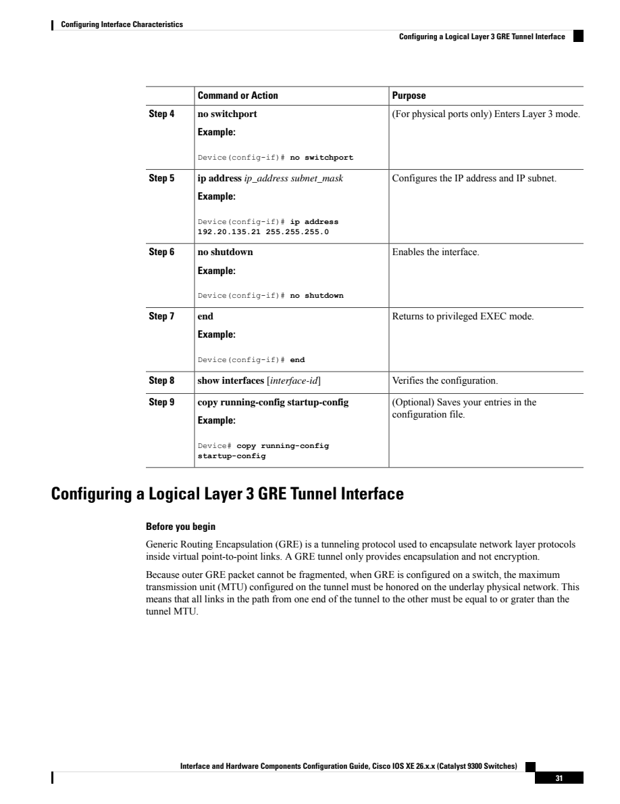
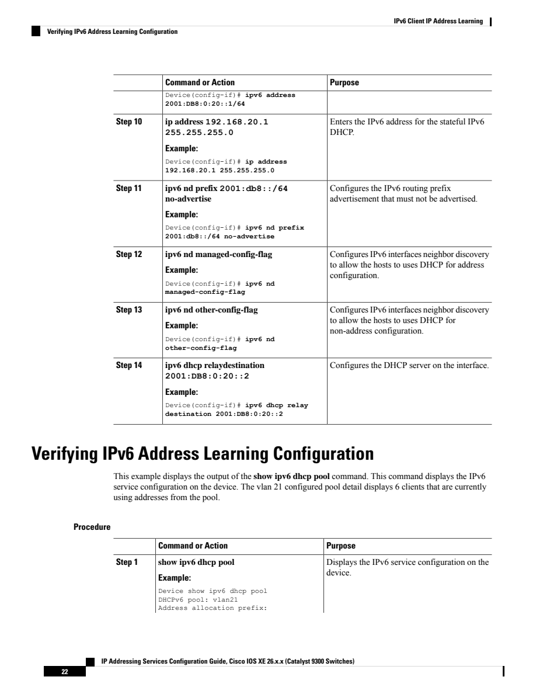
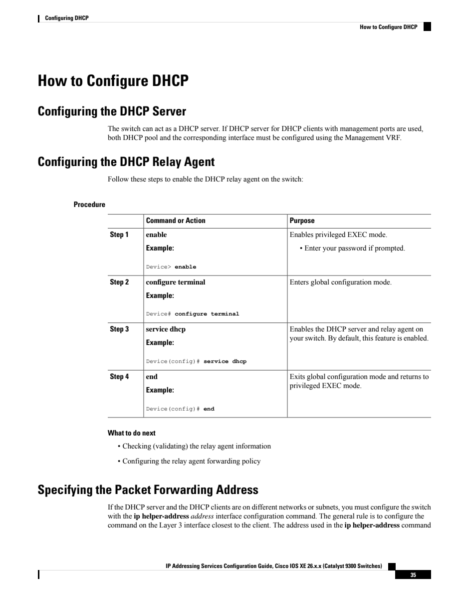
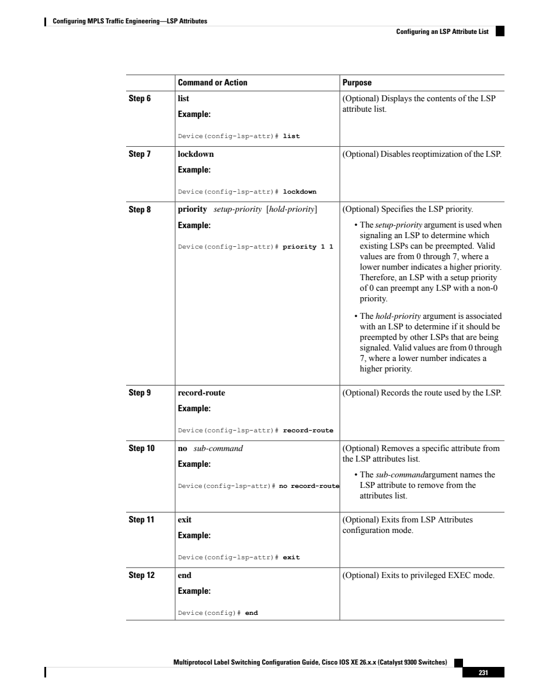

# コマンド例・表の列不整合: 照合結果と目視確認例

## 対象と結果

2026-11-16に作成した全件監査を入力として、18文書の全876候補を照合しました。
件数は旧ID・新IDのパッケージを含み、重複排除した不具合数ではありません。

- [全件集計](summary.md)
- [全876候補のCSV](review_queue.csv)
- [出典ハッシュ・文書別JSONへの参照](manifest.json)

| コマンド例766候補の判定 | 件数 |
|---|---:|
| 対応セクション内で例文の欠落を確認 | 38 |
| セル・行への分断、または例のプロンプト喪失 | 133 |
| 説明列の混入等による監査の誤検出 | 177 |
| 出現箇所や対応範囲が曖昧で判断保留 | 418 |

上表はPDFテキスト・座標による自動照合の判定です。以下の4例は、さらにPDFを
画像へ描画し、OKF本文と目視で比較しました。全候補を人が目視承認したという意味では
ありません。意味的な正しさ、実機への適用可否、未検出の相違は保証しません。

例文欠落38候補のうち、35候補は抽出Markdownの時点、3候補は抽出Markdownから
OKFまでの間に欠落した可能性があります。原因段階は照合範囲に基づく推定です。

表110候補では、行と見出しの列数の揺れを再確認しました。97候補はPDF本文との
断片一致を確認できましたが、13候補は元の表との対応に根拠不足が残ります。
短い行はMarkdownの空セル補完により表示できることもあるため、110候補すべてを
内容欠落とは判定していません。

| 表の形の分類（重複あり） | 該当する表 | 該当する行 |
|---|---:|---:|
| セル内へのコードフェンス混入 | 40 | 215 |
| 見出しより多いセル | 8 | 12 |
| 見出しより少ないセル（空行以外） | 61 | 218 |
| 空の短い行 | 33 | 33 |

外部APIは使用せず、元PDF、抽出Markdown、OKF、既存監査、索引は変更していません。
全876件の監査JSONポインタとCSV行の一致、入力ハッシュの不変を確認しました。
関連テストは38件合格しています。

## 1. Layer 3インターフェース手順表の後半が欠落

- 対象: Interface and Hardware Components、新IDパッケージ
- 出典: [PDFの47ページ](../../products/catalyst9300/raw/catalyst9300-26-x-b-26x-int-and-hw-9300-cg-2a392382640f/b_26x_int_and_hw_9300_cg.pdf#page=47)
- 照合先: [OKF本文](../../products/catalyst9300/packages/catalyst9300-26-x-b-26x-int-and-hw-9300-cg-2a392382640f/manual.md) の1508-1527行
- 判定: PDFに存在する手順表の続きが、抽出Markdown・OKFの対応セクションにない。

PDFにはStep 4-9があり、`no switchport`、IPアドレス設定、`no shutdown`、
保存操作の例を確認できます。OKF側は前ページ分のStep 1-3から次のGREトンネル
手順へ進んでおり、該当する後半がありません。

これは単なる列数の揺れではなく、手順の欠落として優先修正する対象です。
PDFページ数と紙面の印刷ページ番号は異なります。

## 2. Stateful DHCPのStep 10-14が欠落

- 対象: IP Addressing Services、旧IDパッケージ
- 出典: [PDFの40ページ](../../products/catalyst9300/raw/c9300_iosxe26_ip_addr_svc_cg/c9300_iosxe26_ip_addr_svc_cg.pdf#page=40)
- 照合先: [OKF本文](../../products/catalyst9300/packages/c9300_iosxe26_ip_addr_svc_cg/manual.md) の1127-1164行
- 判定: 抽出段階で改ページ後の手順表が欠落している。

PDFでは前ページのStep 9の例に続き、Step 10-14にIPアドレス、IPv6 RAの
prefix制約・フラグ、DHCPリレー宛先の設定が記載されています。
OKF側はStep 9の構文から次の「Verifying IPv6 Address Learning Configuration」
へ移っており、後続の手順と例がありません。

自動集計の「候補」は元監査の検出単位です。このように1ページ分の欠落が複数の
コマンド例や条件を含むため、候補件数と欠落コマンドの総数は一致しません。

## 3. DHCP Relay Agent表にコードフェンスが混入

- 対象: IP Addressing Services、旧IDパッケージ
- 出典: [PDFの53ページ](../../products/catalyst9300/raw/c9300_iosxe26_ip_addr_svc_cg/c9300_iosxe26_ip_addr_svc_cg.pdf#page=53)
- 照合先: [OKF本文](../../products/catalyst9300/packages/c9300_iosxe26_ip_addr_svc_cg/manual.md) の1560-1584行
- 判定: PDFの表に対して、OKFの表セル構造が崩れている。

PDFではStep、Command or Action、Purposeが対応した表です。OKFでは例を囲む
コードフェンスを複数の物理行へ挿入しており、その行のセル数が見出しと一致しません。

コマンド文字列が残っていても、表とコードブロックをそのまま入れ子にした
Markdownは適切な修正結果ではありません。例を表外のコードブロックへ分離するか、
表を維持するならインラインコードとセル内改行へ揃える必要があります。

## 4. MPLSの説明文が余剰セルへ分断

- 対象: MPLS、新IDパッケージ
- 出典: [PDFの253ページ](../../products/catalyst9300/raw/catalyst9300-26-x-b-26x-mpls-9300-cg-b8c1ee43d3e9/b_26x_mpls_9300_cg.pdf#page=253)
- 照合先: [OKF本文](../../products/catalyst9300/packages/catalyst9300-26-x-b-26x-mpls-9300-cg-b8c1ee43d3e9/manual.md) の9072-9111行、特に9090-9093行
- 判定: Purpose内の説明が複数の余剰セルへ分断されている。

PDFではStep 8の`priority`の引数説明がPurpose内にまとまっています。
OKFの見出しは2セルですが、説明の途中の行は7セルへ分かれています。
余剰セルが無視されるMarkdownレンダラーでは説明の一部が表示されないため、
短い行の空セル補完と異なり、優先して元の説明列へ戻す必要があります。

## 保留・制約

- コマンド418候補は、複数出現、PDF列の混在、折り返し、見出しの対応の曖昧さ等が
  残るため、自動的に修正へ進めません。
- 表13候補はPDF本文との対応が未確定です。列数の揺れそのものと、どの元表に
  対応するかの確定を分けて扱います。
- PDF座標の再抽出対象は延べ685ページです。BGP EVPN VXLANのPDF 1236ページは
  テキスト不足として記録しています。このページを含む表候補は判断材料不足を
  解消していません。
- 同じ出典の旧ID・新IDも別々に記録しています。採用対象を決めずに一方を削除・
  上書きしていません。

## 修正する場合の優先順

1. 改ページで消えた手順表・注意事項をPDFから復元する。OKFだけでなく抽出側の
   欠落を扱い、再生成で修正が消えないようにする。
2. 余剰セルとセル内コードフェンスを修正する。例・説明・条件を削除して
   検査を通す方法は取らない。
3. 保留候補の出現箇所と元表を確定し、必要なものだけ修正する。
4. 修正範囲のPDF照合、全件監査、パッケージ検証を再実行してから索引を更新する。

今回は照合のみを行い、これらの本文修正は適用していません。
