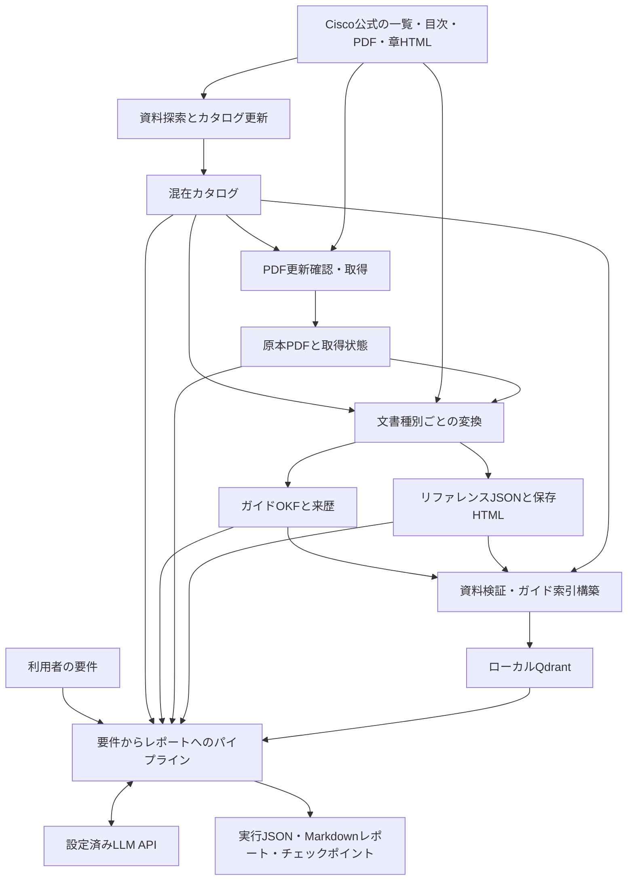
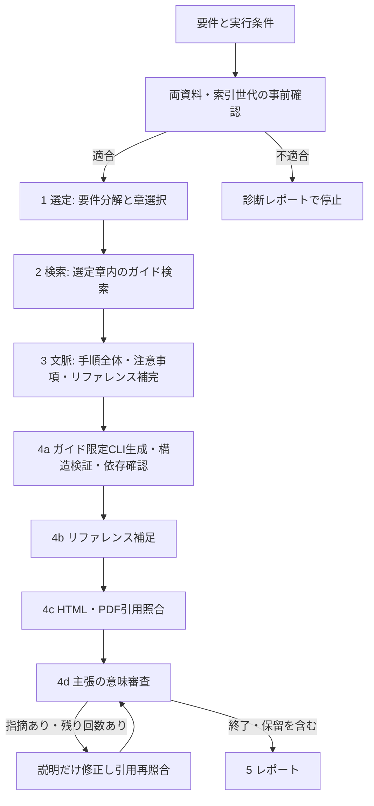

# configbrain 基本設計書（現行実装）

基準日: 2026-11-20

## 1. 本書の位置付け

現在のコードと保存済み実行結果に基づく現状設計書である。
将来構想ではなく「現在どこまで動作し、何を保証しないか」を整理する。
実行結果・改善案・着手順は[進捗管理](./progress.md)に分離し、採用済みの仕様とは扱わない。

- 上位の目的・成功条件、開発手順: [実装ガイド](./implementation-guide.md)
- 処理仕様・データ項目・状態遷移: [詳細設計書](./detailed-design.md)
- 導入・操作方法: [README](../README.md)
- 現在地・評価結果・改善バックログ・再開地点: [進捗管理](./progress.md)

過去の統合設計と中断メモは[履歴資料](./history/command-reference-integration.md)として保持する。
現状の全体像は本書、処理仕様は詳細設計書を入口とする。

## 2. 目的と対象範囲

### 2.1 目的

Cisco公式マニュアルから根拠を追跡できる、評価用のコンフィグ案を日本語で提示する。
全要求を満たせない場合も、根拠のある部分設定・未対応項目・不足情報を残す。
「CLIが生成できた」「引用が一致した」「要件を満たした」を区別する。

### 2.2 対象と対象外

| 区分 | 現在の範囲 |
| --- | --- |
| 対象機種・リリース | Catalyst 9300 / Cisco IOS XE 26.x |
| 入力 | 日本語を含む自然言語要件、公式資料のカタログとローカル資料一式 |
| 出力 | 項目別設定案、確認コマンド、説明、制約、不足情報、引用、診断情報 |
| 実行形態 | PythonのローカルCLI。Qdrantもローカル永続DBとして使用 |
| LLM | 設定された外部チャットAPI。選定・生成・説明・意味審査に使用 |
| 対象外 | 実機接続・設定投入、実機状態の自動取得、動作試験、完成コンフィグの保証 |
| 未提供 | 常駐Webサービス、内蔵スケジューラー、複数利用者向けジョブ管理 |

資料更新を繰り返せるCLI群はあるが、取り込み全体の自動定期実行・一括切替を行う
統合ジョブはない。生成パイプラインも資料を取得・再登録しない。

## 3. 全体構成

### 3.1 二種類の資料の役割

| 資料 | 使用目的 | 検索・保持 | 回答での原本照合 |
| --- | --- | --- | --- |
| コンフィグガイド | 手順、実行用CLIの構文、関連説明・制約 | OKFからガイド本文を埋め込み、Qdrant検索 | ガイド原本PDFのハッシュと物理ページ内のテキスト断片 |
| コマンドリファレンス | デフォルト、モード、引数・条件・注意事項の説明 | 章HTMLを保存しコマンドJSONへ抽出。名前・モード・親で照合 | 保存HTMLのハッシュと再抽出したコマンド範囲 |

**実行用CLIの構文はガイドの手順表のコマンド列に限定する。**
リファレンスの例からCLIやユーザー指定値を追加しない。
リファレンスによる補足・意味修正から設定案を変更することも認めない。

### 3.2 OKFと原本の関係

現在のガイド変換は、PDF本文を直接Markdownへ変換するものではない。
公式の章HTMLから本文・表・コード・画像を抽出し、同じ文書の原本PDFへ来歴を結び付ける。
表は生のHTMLで保持する。PDFは章先頭の対応付けと、生成時の引用照合に使用する。

したがって、OKFの構造検証だけでPDF本文との全面一致が保証されるわけではない。
[実装ガイドの成功条件](./implementation-guide.md#成功条件)にある「原本PDFから生成する派生データ」という目標との関係では、
**HTMLを変換元とする実装上の選択と、PDFに照合できた範囲を区別して扱う必要がある。**
リファレンスの変換・実行時検証はPDFを必要としない。

## 4. 資料取り込みの基本フロー

| 順序 | 処理 | 主な責務 |
| --- | --- | --- |
| 1 | 探索 | 公式掲載元から文書・章を取得し、カタログの追加・変更・削除を検出 |
| 2 | PDF取得 | ETag等とローカルハッシュで更新確認し、一時取得・検証後に置換 |
| 3 | ガイド変換 | 章HTMLからOKFを作り、PDF・HTMLのハッシュ、章・行・画像の来歴を保持 |
| 4 | リファレンス変換 | 保存HTMLと、コマンド・節・明示的な子コマンドのJSONを作成 |
| 5 | 検証・索引登録 | 資料一式を検証し、新コレクションを構築・検証してからエイリアス切替 |

更新単位は文書・パッケージ・索引であり、カタログからDBまでの一つのトランザクションではない。
候補カタログ・別DBでの確認後に切り替える運用が必要である。
同一資料ならPDF取得・変換出力置換・索引再構築を省略できる箇所がある。
ただし、変換CLI自体は章HTMLを取得して再構成し、既存パッケージとの一致を比較する。

## 5. 要件からレポートへの基本フロー

外部から見た段階はselection / search / contexts / generation / reportの5つである。
補足・引用照合・意味審査はgenerationの内部処理で、独立した再開ポイントではない。

1. **事前確認**: 同一製品・リリースの両資料と、それらに対応する索引を必須とする。
2. **選定**: 全カタログをLLMへ渡し、要件項目と関連章を選択する。章は短い候補IDから正規情報へ復元する。
3. **検索**: 選定されたガイド章の中をベクトル検索する。リファレンスはベクトル検索しない。
4. **文脈取得**: ヒットから手順全体等へ展開する。ガイドのコマンドからリファレンス全体への補完照合も行う。
5. **生成**: 項目別にCLIと説明を生成し、構文・値・引用ID・状態を検証する。関連項目だけを上限付きで再生成する。
6. **補足・審査**: CLIを固定したまま説明を生成・審査する。支持できない説明は修正・再審査または保留とする。
7. **レポート**: 設定案を残し、不足・警告・根拠・保留理由を表示する。

## 6. 根拠と品質判定

### 6.1 別々に扱う検証

| 検証 | 確認すること | 確認できないこと |
| --- | --- | --- |
| 資料・索引整合 | 製品、リリース、保存物、ハッシュ、解析結果、資料世代 | 必要な資料をすべて選べたか |
| CLI構造検証 | 許可された手順表構文、指定値・プレースホルダー、項目境界 | 実機上の受理、状態を含む実行可否 |
| HTML／PDF照合 | 引用と保存原本の対応 | 引用が推論・適用条件まで正当化するか |
| 主張の意味審査 | 支持／矛盾／根拠不足と、適用可／条件付き／不明のLLM判断 | 独立した正しさの証明、実機状態 |
| 要件充足集約 | 不足、保留、矛盾、生成・審査失敗の残存 | 実機での要件達成 |

検索スコアや引用一致だけで、正しい結論・適用性・網羅性を保証しない。
同じLLM APIによる別リクエストも、独立した検証機関ではない。

### 6.2 状態の見方

- 項目状態: `supported` / `partial` / `not_found` / `conflict` / `needs_input`。
  CLI生成失敗時は`status: null`とエラーを保存する。
- 生成状態: `complete` / `partial`。説明の生成・意味審査失敗や整合性警告も反映する。
- 要件充足: `complete` / `incomplete` / `undetermined`。
- PDF照合: `verified` / `partial` / `not_verified`。引用単位では複数候補・未一致等も区別する。
- HTML照合: `verified` / `not_verified`。リファレンス引用がない場合も後者となる。
- 実行全体: `completed` / `completed_with_warnings` / `failed`等。

意味審査はCLI生成後の項目状態を書き換えないため、項目が`partial`や`supported`でも
全体の充足が`undetermined`となる場合がある。状態は複数軸を併せて読む。
生成案の`ready_to_apply`、`configuration_complete`、`device_changes_performed`は常に偽とする。

## 7. 運用・保存・再開

- 実行ごとに専用ディレクトリへ5段階の成果物とチェックポイントを保存する。
- 既存出力は通常実行では上書きしない。同条件で`--resume`した場合、保存ハッシュを照合する。
- 再開でも事前確認を行い、保存済み文脈を現在資料から再構成して比較する。
- 警告付きでもgenerationが完了済みなら再利用する。新しい改善の評価には新規runを使う。
- 実行条件・資料世代の変更時は、新しい出力先でやり直す。自動的に不整合を無視しない。
- 単体のreportコマンドは保存JSONから表示するだけで、LLM・Qdrant・元資料の再検証は行わない。

資料ハッシュ不一致などは停止する。一方、PDFの未一致や説明審査失敗は、
有用な設定案を保持した警告付きレポートとする。処理の再試行は各段階の範囲で上限を持つ。

## 8. 実行環境と情報の境界

Python 3.12以上、uv、wget、ローカルQdrant、埋め込みモデル、設定済みLLM APIを使用する。
主要依存は[依存定義](../pyproject.toml)を参照する。

資料取得時はCisco公式サイトへ接続する。生成時に資料をインターネットへ探しに行く
フォールバックはないが、要件・抽出本文・生成結果等は設定されたLLM APIの入力となる。
埋め込みモデルが未配置の場合、モデルローダーが取得を必要とする可能性があるため、事前配置する。
API接続先・認証値はローカル設定として扱い、設計書や実行JSONへ保存しない。

原本・派生資料・DB・runは[Git除外設定](../.gitignore)の対象である。
runには要件・引用本文・LLM応答・ローカルパスが含まれるため、公開可能なログとは扱わない。
保持期間・アクセス制御・同時実行排他の統合管理は未提供で、実行者の運用責任となる。

## 9. 評価と改善の管理

評価では「設定案を生成できるか」「引用が原本に存在するか」
「引用が結論・適用条件を支えるか」を分ける。
スキーマ合格・ハッシュ一致・テキスト一致だけで、意味の正しさや要件充足を保証しない。

基準日の資料構成、demo24の結果、改善バックログと次の着手点は
[進捗管理](./progress.md)で管理する。
検証方法と開発時の合格条件は[実装ガイド](./implementation-guide.md)、
各判定の処理仕様は[詳細設計](./detailed-design.md)を参照する。
